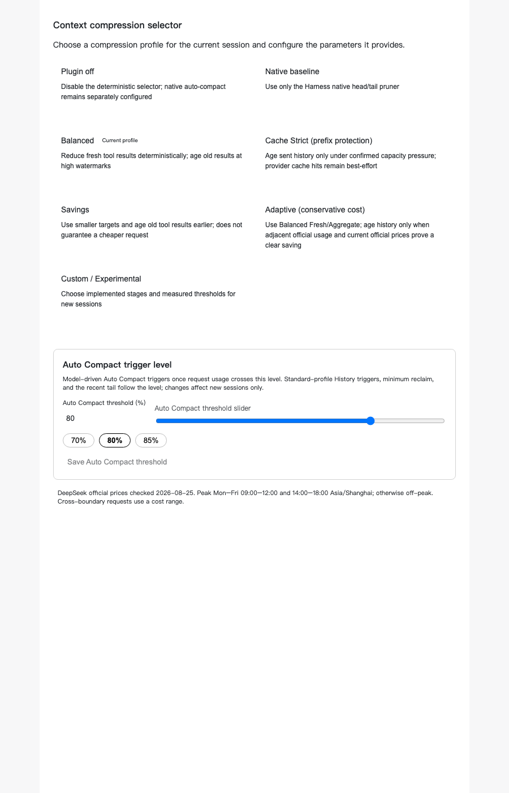

# dsh-context-compression-improved

> **Economia de tokens em primeiro lugar: menos tokens nos resultados de ferramentas a cada turno, totalmente auditável.** Um fork aprimorado do [dsh-context-compression-selector](https://github.com/WilliamShi666/dsh-context-compression-selector) — um seletor auditable de compressão de contexto dos resultados de ferramentas para o DeepSeek Harness — que adiciona uma **porta ortogonal de compressão de esqueletos de código**.

[English](README.md) · [中文说明](README.zh.md) · [日本語](README.ja.md) · [한국어](README.ko.md) · [Français](README.fr.md) · [Deutsch](README.de.md) · [Italiano](README.it.md) · [Русский](README.ru.md) · [Español](README.es.md) · [Registro de mudanças](CHANGELOG.pt.md) · [Guia de instalação](docs/installation.md)

> [!NOTE]
> **O que este fork acrescenta sobre o upstream 0.1.0:**
>
> - Uma **porta ortogonal de compressão de esqueletos de código** (`codeSkeleton.enabled`, desligada por padrão): a primeira exposição de um resultado de ferramenta de código-fonte novo excessivamente grande pode manter um esqueleto de imports e declarações — corpos omitidos, linhas de erro preservadas — antes que os redutores habituais atuem.
> - Uma chave para essa porta na mesma seção de ajustes do seletor, independente de cada perfil de compressão.
> - Uma linha de base de ESLint integrada à CI, um ciclo TDD `test:watch` e documentação em inglês, chinês simplificado, japonês, coreano, francês, alemão, italiano, russo, espanhol e português (Brasil).

> [!IMPORTANT]
> Este projeto suporta **somente modelos DeepSeek**. A medição sem perdas e a compressão com perdas dependem dos tokenizers oficiais da DeepSeek incluídos (`deepseek-v4-flash`, `deepseek-v4-pro`, `deepseek-v4-flash-vision-exp`). Todo o resto falha de forma aberta (fail-open) e conserva os resultados de ferramentas originais. Consulte o [README do upstream](https://github.com/WilliamShi666/dsh-context-compression-selector#model-support-and-safety) para conhecer o modelo de segurança completo.

<!-- host-compat:begin — generated by scripts/sync-hosts.mjs from scripts/hosts.mjs; DO NOT EDIT -->
- **Hosts DSH compatíveis:** `0.1.0-rc.2` `0.1.0-rc.3` `0.1.0-rc.6` `0.1.0-rc.7` `0.1.0-rc.8` `0.1.1-rc.1` `0.1.1-rc.2` `0.1.2-rc.1` `0.1.5-rc.1` `0.1.5-rc.2` `0.1.5-rc.3` `0.1.7-rc.1` `0.1.7-rc.2` `0.2.0-rc.1` `0.2.0-rc.2` `0.2.1-rc.1` `0.2.1-rc.2` `0.2.1-rc.3` `0.2.1-rc.4` `0.2.1-rc.5` `0.2.2-rc.1` (21 rc nas linhas 0.1.0 / 0.1.1 / 0.1.2 / 0.1.5 / 0.1.7 / 0.2.0 / 0.2.1)
<!-- host-compat:end -->

## O que é

Tarefas longas de agentes acumulam uma grande quantidade de saída de ferramentas. Este plugin comunitário acrescenta políticas selecionáveis e auditáveis para reduzir esse contexto de resultados de ferramentas sem modificar o núcleo do DeepSeek Harness:

- **Fresh** pré-comprime um segmento de resultado de ferramenta recém-obtido excessivo antes que o modelo o receba.
- **Aggregate** pré-comprime de novo o material fresco quando ele ainda cresce além do seu orçamento.
- **History / micro-compact** substitui resultados antigos de ferramentas elegíveis preservando o contexto de trabalho recente.
- **TailTrim** é um caminho opcional de redução de cauda, exclusivo do Personalizado.
- **Native** conserva o corte de cabeça/meio/cauda ao estilo do Harness como um perfil explícito.
- **Esqueleto de código (novo, porta ortogonal)** — veja abaixo.

Cada decisão é registrada: fase, redutor, gatilho, motivo da omissão e contagens exatas de tokens quando disponíveis.

## Porta de esqueleto de código (nova)

Quando a porta está ativada, um **resultado de ferramenta de código-fonte novo** excessivamente grande (por exemplo, um `read_file` grande) tenta primeiro uma redução a esqueleto: os imports e as declarações de tipos/funções/classes são conservados, os corpos das funções são omitidos com um marcador e as linhas de erro dentro dos corpos omitidos são preservadas. Se o esqueleto não puder ser produzido ou verificado, o resultado recorre ao corte de cabeçalho original — a porta nunca pode piorar o contexto.

Propriedades:

- **Ortogonal**: independente do perfil selecionado (`balanced`, `savings`, `cache-strict`, `adaptive`, `custom`, `off`, `native`). Todos os perfis recebem a porta.
- **Desligada por padrão**: `codeSkeleton: { enabled: false }` até você ativá-la.
- **Sujeita à medição**: requer o tokenizer exato da DeepSeek; sem ele, o plugin falha de forma aberta (fail-open).
- **Congelada por sessão**: como todos os ajustes do seletor, as mudanças afetam apenas as sessões observadas a partir de então.
- **Análise estrita**: `codeSkeleton` deve ser exatamente `{ enabled: boolean }`; valores malformados geram erro no runtime e aparecem como ilegíveis na interface do navegador.

## Interface de ajustes

Escolha um perfil de compressão, configure o nível de disparo do Auto Compact e ative a compressão de esqueletos de código na mesma seção de ajustes. A chave salva a cada mudança e mostra o estado salvo ao recarregar.



## Instalação

**Recomendado: instalar a partir do npm.** Uma única versão cobre todas as linhas compatíveis do Harness — `latest` traz a enumeração completa de 17 rc (0.1.0-rc.2 → 0.2.1-rc.2); o runtime escolhe sozinho os caminhos de código de cada linha.

```sh
dsh plugin --profile web add dsh-context-compression-improved@latest
dsh --profile web --dump-config
```

A partir do código-fonte (alternativa — os nomes internos dos pacotes permanecem deliberadamente os do upstream):

```sh
git clone https://github.com/drscrewdriver/dsh-context-compression-improved.git
cd dsh-context-compression-improved
pnpm install --frozen-lockfile
pnpm build
```

Depois empacote o pacote selector e adicione-o a um perfil do Harness — o percurso completo, inclusive a verificação e a desinstalação, está no [guia de instalação](docs/installation.md).

## Desenvolvimento

```sh
pnpm install --frozen-lockfile
pnpm lint          # linha de base ESLint (também exigida na CI)
pnpm typecheck     # tsc de runtime + selector + testes, mais a etapa de bundle
pnpm test          # suíte vitest completa
pnpm test:watch    # ciclo TDD: escreva primeiro a regressão que falha, depois a faça passar
pnpm build
pnpm verify:release
```

As contribuições seguem a disciplina do upstream: acrescente primeiro a regressão que falha, mantenha cada mudança de produção dentro deste repositório e explique separadamente as evidências de “disparado”, “ativado mas ignorado” e fail-open. Veja [CONTRIBUTING.md](CONTRIBUTING.md).

## Compatibilidade

- Compilado e testado contra as versões oficiais do DeepSeek Harness; os peers declaram a lista completa de suporte (`0.1.0-rc.2` → `0.2.1-rc.2`, sete linhas) e o plugin usa apenas APIs públicas de plugin e de perfil. A lista é gerada pelo `scripts/sync-hosts.mjs` a partir de `scripts/hosts.mjs` no bloco gerenciado acima.
- Requer Node `^22.19.0 || >=24` e pnpm `11.7.0`.
- O plugin usa apenas APIs de extensão públicas do Harness e não modifica o código do núcleo do Harness. Projeto comunitário não oficial, sem afiliação nem endosso da DeepSeek.

## Créditos e licença

- Projeto upstream e trabalho prévio: [WilliamShi666/dsh-context-compression-selector](https://github.com/WilliamShi666/dsh-context-compression-selector) de WilliamShi666 (MIT).
- Adições do fork (porta de esqueleto de código, ferramentas, documentação localizada): drscrewdriver.
- MIT — veja [LICENSE](LICENSE) (aviso de copyright do upstream conservado) e [THIRD_PARTY_NOTICES.md](THIRD_PARTY_NOTICES.md) para a procedência dos tokenizers incluídos.
